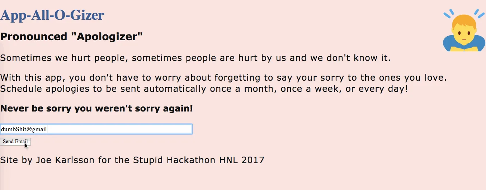

# App-All-O-Gizer
### (ə-pŏlˈə-jīz ə(r))

Sometimes we hurt people, sometimes people are hurt by us and we don't know it. With this app, you don't have to worry about forgetting to say your sorry to the ones you love. Schedule apologies to be sent automatically once a month, once a week, or every day! Never be sorry you weren't sorry again!

Built in a day at the [Stupid Shit No One In Hawaii Needs and Terrible Ideas Hackathon](https://stupidshitnooneinhawaiineedshackathon.github.io/) in January 2017. The site that ran it, appallogizer.com, is offline now, so this is the demo from 2017.


## Artist statement

I built App-All-O-Gizer in a day at the Stupid Shit No One In Hawaii Needs and Terrible Ideas Hackathon in January 2017. The schedule never got built. I installed node-cron and ran out of day, so every click sends one apology right away. An apology app that never followed through seemed right for this hackathon.

[Read the full statement](https://www.joekarlsson.com/work/app-all-o-gizer/).

## Screenshots



Type an address, click once.


One of the 13 apologies it picks from.


## Getting Started
1. Fork and clone
1. Run `npm install`
1. Add your Gmail address and password to environment variables. Gmail no longer accepts your account password here, so use a [Google App Password](https://support.google.com/accounts/answer/185833) (it needs 2-Step Verification on). In your terminal run:
  1. `export email=YOUR_EMAIL_ADDRESS@gmail.com` and
  1. `export pass=YOUR_EMAIL_PASWORD`
1. Run `npm start`
1. Open your browser to `http://localhost:3000/`
1. Never be sorry you weren't sorry again!

## Contributing
1. Fork it!
1. Create your feature branch: ```git checkout -b my-new-feature```
1. Commit your changes: ```git commit -am 'Add some feature'```
1. Push to the branch: ````git push origin my-new-feature````
1. Submit a pull request :D
